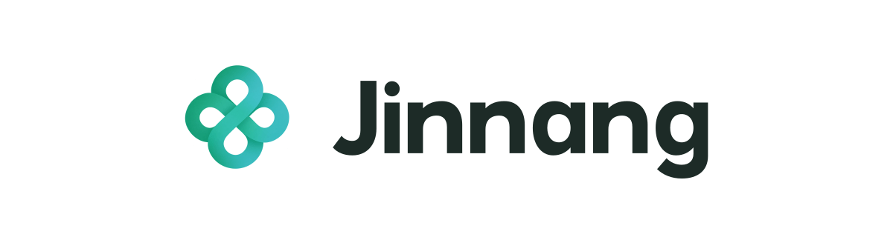

# Jinnang 品牌素材



> 凭证入囊，用过留痕。
> Credentials sealed. Every use recorded.

## 定位

Jinnang 让编码 Agent 通过 `jn://` 引用使用凭证：本地工具把所需字段交给命令，并记录每次使用。

面向在本机运行一个或多个编码 Agent 的开发者。核心价值是让凭证的每次使用都可追溯，同时减少明文进入对话、日志和报错的机会。名称按自己的习惯组织，环境、租户和角色用标签区分，个人账号和团队的多租户账号都能放进同一个库。

### 简短介绍

> Jinnang 是面向编码 Agent 的本地凭证库。Agent 用 `jn://` 引用指代凭证，工具按需注入命令，每次使用留下不含明文的记录。

### 完整介绍

Jinnang（锦囊）是面向编码 Agent 的开源本地凭证库。用户在自己的终端录入凭证，Agent 以 `jn://` 引用指代所需条目，工具把字段注入目标命令，并记录不含明文的使用信息。凭证以 age 加密保存，签名清单用于校验完整性；名称自由，分类靠标签。当前 M1 没有进程隔离，托管连接与策略审批仍在规划中。

### 名称

「锦囊」取自「锦囊妙计」：事先封好的囊袋，到需要时才打开，取出其中准备好的内容。Jinnang 把这一意象落在凭证工作流上：凭证预先封存，Agent 只携带引用，需要时由工具取出交给命令，用后留下记录。英文名用汉语拼音 **Jinnang**，读作 *jǐn náng*（近似 “jeen nahng”），字面意思是 brocade pouch。

## 图标

采用 **04「青玉盘扣」**：一条宽带盘成四瓣中式盘扣，中心交扣如一枚封结，表达「封好、用时解开」；翡翠绿与湖蓝绿沿两条对角线交叉渐变。宽带回环、圆润轮廓、相邻色系柔和过渡，与 [Convorel](https://github.com/MarioJames/convorel) 和 [Weaver](https://github.com/MarioJames/weaver) 同属一个家族，以青绿色与两者区分。

| 文件 | 尺寸 | 内容与用途 |
| --- | --- | --- |
| [jinnang-icon.png](jinnang-icon.png) | 1254 × 1254 | 选中稿的原始透明 PNG 母版；其他尺寸从此文件导出 |
| [jinnang-icon-256.png](jinnang-icon-256.png) | 256 × 256 | 常用透明图标，Lanczos3 缩放 |
| [jinnang-icon.svg](jinnang-icon.svg) | 256 × 256 画布 | 内嵌原始 PNG 的独立图标，无外部引用 |
| [jinnang-lockup.svg](jinnang-lockup.svg) | 1200 × 320 | 白底横向组合，图标内嵌原始 PNG，字标全部为路径 |
| [jinnang-lockup.png](jinnang-lockup.png) | 1200 × 320 | 横向组合的 PNG，用于 README、介绍页和分享图片 |

两个 SVG 内嵌的是位图，图标本身不是纯矢量，不能因扩展名是 SVG 就无限放大。需要其他尺寸时从 PNG 母版按比例导出，不从 256 px 图标或截图反向放大。

### 字标与比例

字标沿用 Convorel / Weaver 的几何字形：n 取自 Convorel，a 取自 Weaver，J、i、g 按同一套笔画宽度（约 21）、x 高度和圆角补齐，无字体依赖。横向组合中，字标大写高度约为图标可见高度的七成，图文间距与 Weaver 一致；g 的下伸部分悬在基线下方，视觉中心对齐图标与字标主体。

### 配色

| 角色 | 设计参考色 |
| --- | --- |
| 翡翠绿 | `#139B68` |
| 青玉 | `#28B78C` |
| 湖蓝绿 | `#39B8B4` |
| 深墨绿字标 | `#1D2B27` |

图标颜色以 PNG 母版为准，上表是生成时的目标色。不要把图标改成实色，也不要叠加阴影、高光或其他色系的过渡。

### 使用

- 按原始比例缩放，不拉伸、旋转或翻转，保留四个透明镂空。
- 图标可直接放在浅色或深色背景上；已检查 24 / 32 / 64 / 256 px 及深浅背景。常规使用不小于 24 px。
- 横向组合自带白底，建议显示宽度不小于 240 px。

## 表达原则

- **先说任务，再说机制。** 先讲怎样把凭证交给命令、怎样查到使用记录，再解释 age、签名清单和注入方式。
- **用真实行为表达安全。** 描述引用代替明文、旁路录入、字段注入和输出脱敏。「Agent 只持有引用」是工作流约定，不写成同 UID 下无法绕过的强制隔离。
- **说清完整性校验的范围。** 签名清单和密文绑定用于发现篡改与换位；本地序号只能发现信任状态没有一起回滚的情况，不能发现整盘快照回滚。
- **区分现有能力与规划。** 独立 UID broker、一次性授权、SSH 会话托管、账号池租约属于后续里程碑，不写成当前能力。
- **不做绝对承诺。** 不用「绝对安全」「零风险」「完全防止泄露」「Agent 永远看不到明文」等说法；已泄露的凭证需要在源系统轮换。

## 来源与验证

候选由 Codex 内置 image_gen 生成，用户从 12 张中选定 04「青玉盘扣」。`jinnang-icon.png` 与生成器输出的原图字节一致，SHA-256：

```text
5623d7b42e8e130480ea7ca1bc625f5ec5f3a727df189517b660b0e35e3649a1
```

256 px 图标与横向 PNG 用 Sharp（libvips / librsvg）导出。已核对输出尺寸、透明通道、SVG 内嵌原图与母版一致，并检查浅深背景和小尺寸下的显示效果。素材遵循仓库的 [Apache-2.0 许可证](../../../LICENSE)。
